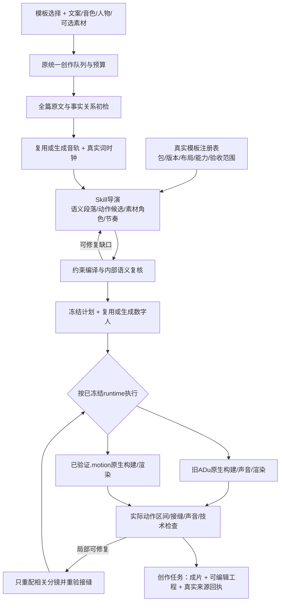

# ADu 原生模板与 Skill 融合方案

日期：2026-10-15。状态：**已完成审计与设计，以下目标架构待实施**。本轮没有修改应用、默认模板、现有任务、外部引擎或付费状态，没有生成新视频、登录下载个人包或部署线上。

## 1. 结论与用户目标

目前不是完整融合。专业动效入口已真实连接旧 ADu 规划、构建、音效、混音、渲染和工程导出；简化数字人口播的04-A默认分支绕过该流程，使用另写的 `studio-instrument-v1` Remotion 组件。相同颜色、双球和模板名称不能证明继承了原版编舞。上一轮得到的52.967秒视频保留为历史自有适配版，不作为ADu原版效果基准。

目标是：**用户选择的实际模板包决定最终动画代码、对象行为、转场和声音；后台 Agent 承担 Skill 中的导演工作，原生运行器承担确定的构建工作。** 普通用户只需选择模板并提供文案、音色、人物和可选素材，点击制作后在创作任务查看进度、播放和下载。

融合验收要回答两个独立问题：是否执行了所选包的真实代码？这些动作是否忠实表达本篇台词？只验证文件能渲染或 `styleId` 相同，两个问题都不能充分回答。

## 2. 已核实的现状

| 能力 | 当前实际状态 | 目标处理 |
| --- | --- | --- |
| ADu固定旧引擎 | 已接3.14.0-rc.1 / `f52490bd` | 保留为独立、可重现的旧工程适配器 |
| 专业编辑原生链路 | `auto-plan → auto-build → audio → mix → render → check → preview` 已在代码中调用 | 复用并纳入简化入口，普通用户不填专业字段 |
| 简化04-A默认生成 | `prepare` 返回instrument，直接调用自写组件 | 取消其作为ADu默认实现的绑定；自有适配版使用独立身份和名称 |
| 内容规划 | 先固定素材镜头，再尝试匹配动作组 | 改为全篇语义、模板能力和真实时钟共同决定镜头；素材可供重配 |
| 语义证明 | native `brief`直接从组元数据复制phases/counts；文字槽普遍引用整个段落 | 每个动作阶段、对象、数量和文字有独立原文依据，防止用模板要求代替文案事实 |
| 身份检查 | `verify`只比`adu:04-A:portrait`字符串 | 校验真实包、版本、布局、运行器、源码/计划摘要和逐场来源 |
| 模板预览 | 上游局部演示、自写示意图、实际渲染并存 | 同一包版本、同一画幅、同一运行器；参考样片和本期预览明确区分 |
| 局部重配、手绘、质量修剪 | 部分只提供guide，不能等同自动执行 | 按执行能力逐项登记；首期接原生局部重配，方法说明不冒充按钮能力 |
| MotionGit新包 | 尚未取得或执行 | 管理员导入真实包、验证运行器后再开放制作 |
| 付费恢复/统一队列/创作关联 | 已有耐久意图、预算和原产物复用 | 保留同一父任务和费用合同，修排版不重新生成数字人 |

本地证据入口：`Haike_video/backlot/studio_preflight.py:40`、`studio_presentation.py:44`、`studio_storyboard.py:547`、`studio_motion.py:245/334/367`。实际任务 `PQ-a33a7f4bd35da401bb9c` 的 `presentation.json` 记录adapter为 `studio-instrument-v1`，没有该次ADu原生规划回执。只读探针证实当前身份检查能接受“相同styleId、不同adapter”。证据在忽略目录 `output/adu-fusion-design-20261015/current-route-audit.json`。

本轮免费能力探测实际返回：竖屏11风格/54组，横屏10风格/47组；04-A分别选择 `doubao-console-performance@0.3.1-candidate` 和 `@0.3.0-candidate`，各4组。它们是可比较能力数量，不是54/47组已完成产品声画验收。完整一手来源与版本核对见 [上游研究](../research/ADU_UPSTREAM_CAPABILITIES_20261015.md)。

## 3. 版本路线：旧 Skill 与新 .motion 分开接

上游main `31a03c36` 仅比固定安装多一次README/图库更新，没有引擎或旧包更新。因此不能靠一次git pull解决效果问题。官方已转向[完整.motion包](https://github.com/adunext/adu-motion-video/blob/31a03c36b5f510303305f9e931c448b75baa52d5/README.md)，旧Skill作为旧工程兼容入口保留。

新版[仪器台竖屏页面](https://motiongit.com/@adunext/template-04-dark-console-portrait)声明v2.5.0、1080×1920/60fps、native/components，以及更广的组件能力，但页面运行验证仍为Not verified。公开下载实际需要登录。本轮未取得包字节，不能把这些声明写成本机可用或已适配本故事。

设计采用两个真正的运行适配器，共用业务接口，不把两套内容互相伪装：

- `LegacyAduRuntime`：调用固定旧CLI，保持原包、profile、完整动作组、受保护时钟和旧工程原字节。
- `MotionGitRuntime`：读取经验证的实际个人包，按其内容/交付合同及受信入口执行。支持的runtime/profile由真实包决定，不硬猜所有.motion都是同一种Remotion工程。

[开放内容规范](https://motiongit.com/spec)当前为0.1.0-draft.1，[个人交付外层](https://motiongit.com/spec/personal)为1.0.0-rc.1/personal-download-v1；模板v2.5.0属于另一个版本维度。首期仅实现取得并验证的runtime，其他包明确标为待支持。若包依赖官方解锁或网络服务，记录实际依赖，不称纯离线可用。

模板包导入属于管理员的一次配置。原个人包私有保留，宿主使用官方受验证入口处理其身份，不手动提取Key、不绕过保护、不把个人包及凭据打进Git或用户工程导出。渲染不得隐式启用包内在线生成；海客原配音、数字人及预算继续沿用。若运行所需授权不允许该产品使用，包保持未开放，不用另写仿版代替。

## 4. 目标架构

### 4.1 真实模板注册表

使用不可混淆的`TemplateRef`，至少保存：作者/来源、包ID、确切版本、画幅、原生或衍生模式、实际包SHA、运行器/profile与版本、manifest/源码/profile摘要、支持场景/组件、参考预览来源、许可与验证范围。

例如旧竖屏04-A应指向具体的 `doubao-console-performance@0.3.1-candidate`，而不是只有`04-A`。自写故事版应为 `haike:instrument-story@独立版本`，不得借用原作者包身份。新.motion须在取得实际文件后绑定完整哈希，网页摘要前缀不能代替包校验。

状态分开记录：已识别、可规划、可构建、技术检查通过、已做声画基准、可用于当前项目。网页“有模板”和宿主“支持制作”是不同状态。模板库只为已具备本地运行合同的包显示制作按钮；未就绪包展示清楚的管理员导入/适配状态。

### 4.2 后台Skill导演

不把整份SKILL.md当一个万能提示词。把其规则固定为版本化执行策略，并让后台Agent只调用已登记的规划、素材和渲染工具。输出是可验证的结构化计划，不能输出任意shell或随意改渲染源码。

分两次前检：文案输入后先做无需收费的语义可行性检查，明显不满足所选模板时不先生成整条数字人；取得真实音轨后再核对词级锚点、受保护动作窗、总帧数及素材区间。

导演从完整原文提取：真实实体、否定/转折/因果、数量和单位、关键短语、段落目的、真实素材角色及来源。保存原文字符区间与词时钟引用；每个phase和显示事实分别有依据。**不能读取模板要求“三步”，就直接宣称台词含有三步。**

规划顺序为：语义可行候选→实际动作容量→媒体输入与同一对象继承→接缝和声音→全片节奏。保留多种有依据的完整分段方案；用户锁定单一模板时`allowedStyles`只含该模板。先把B-roll切成8镜再机械挑8个动画，不是目标流程。[上游规划职责](https://github.com/adunext/adu-motion-video/blob/f52490bd1ec37370091982d853990725b340f3f5/references/automatic-selection.md)

可自动补齐短标题、模板允许的装饰纹理/字体、真实素材缩略图与合法区间；不可补造原文没有的步骤、参与者、结果、金额或精确词时码。字体默认按上游preferred策略回退并检查排版，不能因旧目录残留字体硬要求阻止用户。

### 4.3 约束编译与原生执行

旧运行器把真实内容计划编译为`adu-auto-brief/1`，调用原生auto-plan；单一包可按实际接口使用macro-plan。新版按取得包的实际schema/入口编译，不预先发明具体命令兼容层。

编译器保留`contentEvidence`、逐阶段/文字槽原文依据、真实数量、word cue、媒体SHA/offset、完整分段、原生组ID及选型淘汰原因。原生ready只是绑定检查，不覆盖内部语义复核。

画面动作使用包的受保护编舞时钟，真人/字幕/声音使用实际输出时钟。只拉伸合同允许的阅读停留区，不整片变速、循环动作或冻结真人补时长。SFX映射真实动作事件并保留声尾；BGM在同一制作表单中明确显示当前声音方案，随提交冻结，不另弹审核，也不在后台硬编码为none或隐式付费生成。

同一父队列执行构建、声音、渲染和核验，不能另开一条不受控生产队列。旧原生`studio_motion`保留兼容；简化口播调用同一执行模块。可编辑工程与MP4使用同一冻结计划。

### 4.4 小接口与修改位置

| 模块 | 对外职责 | 主要改动位置（拟议） |
| --- | --- | --- |
| TemplateRegistry | resolve固定引用，返回真实能力与预览 | 新`studio_template_registry.py`，替代catalog里的旁路身份拼接 |
| SkillDirector | content/clock/assets/template→有依据的全片计划 | 新`studio_motion_director.py`；收拢`select_motion`，复用原TrialRelay及额度 |
| RuntimeAdapter | describe/compile/build/render，隐藏两种引擎差异 | 新`studio_motion_runtime.py`，内部复用原`studio_motion.py`CLI实现 |
| MotionQA | 来源、语义、动作、声画和技术证据→分层结果 | 新`studio_motion_qa.py`，复用现有探测和视频理解能力 |
| 原编排入口 | 管理原预算、原意图和断点，不拥有另一套模板渲染器 | `studio_avatar.py` / `studio_preflight.py` / `studio_creation.py` |
| UI | 真实模板选择、制作、进度与结果；专业操作为可选 | `AvatarTemplatePicker.jsx` / `App.jsx` / `Motion.jsx` / `CreationTasks.jsx` |

这是提议的模块拆分，不要求一次搬迁全部旧代码。先让当前专业与简化入口共用同一原生执行模块，避免再增加一套旁路；旧自有适配器只有明确独立模板选择时保留调用。

## 5. 用户交互：自动处理复杂度，保留真实选择

默认流程只有“选择模板→填写四项内容→制作视频→创作任务”。模板卡显示真实完整动作预览与适用表达，例如“技术流程/输入汇聚/结果交付”，而不是只放一张暗色截图。管理员一次验证一个包后，普通用户无需逐场确认。

前端区分两种意图：用户明确选择原版时锁定原包；允许风格适配时也只能采用已登记、已说明来源的同风格组件/衍生版本。原版和衍生版的选择值必须不同；不能靠隐藏高级选项或同名ID把自写组件当作默认原版。

内部自动完成分段、短标题、词时码、素材取舍、字体、构图、局部重配与质量核验。任务阶段显示“理解文案→按模板编排→准备人物→合成动画→检查声画→完成”；步骤来自真实执行，不用计时伪造进度。必要时可展开“制作说明”，普通用户不用阅读JSON、cue、包版本或接缝报告。

用户只在三类情况需要一次集中处理：缺少无法代推的真实输入；所选模板确实没有可行表达且必须改变选择/文案；新增收费或突破原预算。发布继续沿用现有单次明确授权。不能因为内部结构检查、每条素材取舍或每个镜头修复反复问用户。

原文不兼容时，制作前直接显示具体理由和可行替代，而不是等数字人付费后失败；可重新合并语义段、选择同包合法组件、在授权范围内获取素材并自动修复。若仍无合法路径，保持原文、包和已生成产物，不能为“顺利完成”编造步骤或暗换模板。

### 预览与成片一致性

模板参考预览绑定确切包版本、画幅、模式和组，不用横屏3.9秒局部代指任意竖屏整片。本期预览来自同一编译计划与原生运行器；低分辨率预览只改编码配置，不能换另一套动画代码。

内部排版占位片只用于生成前约束检查，不能当本期真人成片交付。实际人物就绪后检查完整动作区间与接缝。最终任务保存包/计划/输出摘要以及逐场组来源，不仅显示模板名称。

## 6. 自动核验与恢复

内部检查分两轮：结构/语义轮与实际声画轮。原生编译诊断最多按上游建议做三次有边界的合法调整；模型调用、时长和总费用另受现有额度控制，不自动扩大。技术检查可以随局部修复重跑，不将其伪称额外人工审片。

结构轮检查原文不重不漏、事实对应、固定数量、真实媒体、word cue、完整动作窗、同一对象与相邻约束；声画轮看关键动作前中后、完整运动区间、接缝、最长文本、人物极端姿态、字幕遮挡、音效落点、声尾和实际混音。技术层另验音视频流、帧数、完整解码、色彩与响度。

画面抽样和自动模型都不能证明每一帧与听感完美；回执记录实际核验范围。首套模板做一次同输入原生基准及用户最终效果确认，后续常规任务自动核验、直接可播放下载，不逐镜让用户审核；发布仍独立授权。

每阶段按包/计划/输入/工具版本指纹保存产物。仅换模板时复用TTS、ASR、数字人及仍有效素材；改一个素材只重配该段并重验两侧接缝。改原文或音色才按实际影响范围判断是否需新生成与费用确认。原未知提交只查询原意图，不覆盖账本。纯本地重排缺产物时停止，不回退新付费。

MotionGit个人包的身份/凭据/许可和海客模型账本分开：不因本地渲染而启用新的平台收费能力；正式分发前还需核对宿主和工程导出的实际许可范围。管理员导入失败给出具体原因，不能用网页元数据伪装成功。

## 7. 当前讨欠款故事怎样处理

当前冻结文案279字、原声52.96秒，主要关系是提问→春节催款→14个月结算款→“年后优先”→钱与欠条的反转→应收款共鸣→30平方米/9万8的小生意。原文和音频保持不动。

旧04-A四组要求：双输入合并；三步骤/六检查；三执行者/七步骤/一交付；以及相同结构的结束扩展。它们不是任意故事段落，不应把14个月、30平方米和9万8硬凑成三步骤，也不循环三个短组覆盖53秒。[原生包合同](https://github.com/adunext/adu-motion-video/blob/f52490bd1ec37370091982d853990725b340f3f5/packs/doubao-console-performance/0.3.1-candidate/manifest.json)

实施时先在真实包上验证：新版native/components是否确有适用的叙事能力、是否能保留原生动效。可行时按下表规划，再用真实词时钟决定动作位置；本表没有编造秒数，且**不是已可执行的新场景承诺**。

| 原文段落 | 候选表达与必须保留的含义 |
| --- | --- |
| “去年大年三十，你在哪” | 问题入场、人物在场、仪器台主题建立 |
| 办公楼下等结算款 | 证据素材窗与故事状态推进，不伪造实际当事人或账单 |
| “十四个月”“年后优先” | 真实短语随词时钟激活时间/信息卡；无虚构精确日期 |
| “不是钱，是欠条” | 对比与反转动作；不能误用“两个输入合并成功”表达 |
| 应收款共鸣 | 多条抽象欠款/回复的示意表达，不画成真实用户财务记录 |
| “30个平方，9万8” | 场景与数字/单位强调，保留小生意引入，不添加未提供收益结论 |

若新包没有这些合法能力，另做经过验收、明确衍生身份的仪器台叙事包；需要真实动画实现、输入契约、动作窗、SFX和新的效果确认，不能给现有双球呼吸组件换名字。若用户坚持精确原版且没有可行组，系统说明内容适配缺口，不能承诺“任意文案无损复刻”。

## 8. 实施顺序与完成标准

| 阶段 | 交付 | 必须通过的证据 |
| --- | --- | --- |
| P0 身份与基线 | 真实包注册；原版/自有版分离；停止同名默认旁路 | 同styleId但非所选运行器必须被拒绝；用语义兼容的固定fixture在旧原生引擎做基准，不拿本故事硬凑 |
| P1 真正的Skill导演 | 全篇事实映射、多方案分段、真实cue和模板字段编译 | 无“三步骤”的故事不能被伪造为三步骤；字段各自有依据；先语义检查、再昂贵人物生成 |
| P2 新.motion接入 | 管理员一次导入；真实runtime适配；参考/本期预览统一 | 验证实际包而非网页；不支持profile明确拒绝；原生成图/声音服务保持关闭；未知/离线状态不冒充验收 |
| P3 自动质量与本地恢复 | 内部两轮检查、局部重配、费用/阶段复用、原队列与任务回执 | 坏接缝/声尾/裁切能定位具体段；重排没有TTS/avatar新提交；历史版本仍可播放 |
| P4 当前故事与模板推广 | 依据真实能力制作本故事；最后推广到其它模板 | 原版基线与本期适配分别看完整动作和声音；原版/衍生来源清楚；用户一次看最终效果后再决定开放范围 |

P0/P1可基于现有固定引擎推进；P2必须先有正常取得的实际新包，不能用假包或网页预览占位宣布完成。P4不是把所有模板一次标记全通过：每个runtime、画幅和候选包保留自己的验证范围。

验收矩阵至少包括：同输入原生源码重放与原参考动作对照；新文案完整动作及原词时钟；长标题/缺素材/错误数量/短段/长段/无匹配；横竖屏独立布局；相邻对象继承与跨场SFX尾音；用户选择包与实际工程摘要一致；假adapter同名攻击被阻断；新旧版本与预览一致；本地断点恢复与费用0增量；普通用户从四项输入直接到任务成片且无逐镜审核。

完成的判断是**按所选真实模板制作、台词与动作有依据、实际效果成立**，不是通过了多少测试、能否播放MP4或是否显示相同模板名称。

## 9. 本轮完成的研究验证

已读本地调用链与原任务回执；免费运行两种画幅auto-capabilities；执行不修改状态的模板身份探针；查看原3.9秒局部演示的全部11个概览采样并提交独立分析，明确production_ready=false。未连续播放原版全片或核验其音效，本轮不作原模板视觉验收。

研究文件保存上游精确commit、原生包合同、新版.motion公开声明和未取得包的限制。所有本机证据位于忽略目录`output/adu-fusion-design-20261015/`；不包含凭据或新生产视频。应用的改动、模板导入和当前视频重做均属于后续实施。
